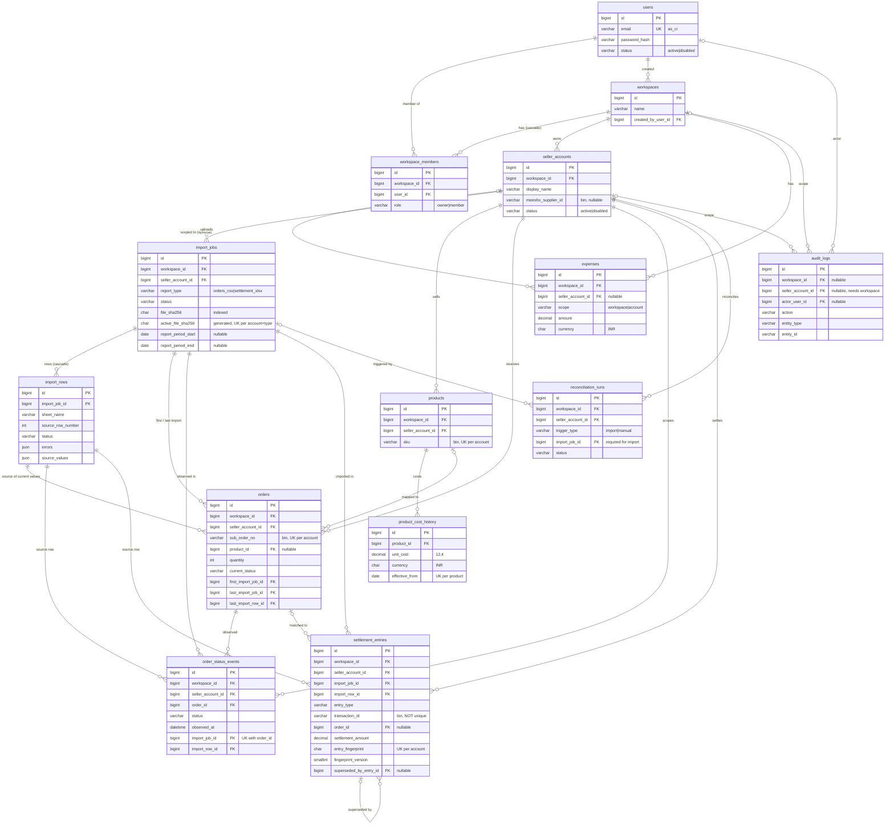

# Database schema (Milestone 2)

MySQL 8.0 (InnoDB, `utf8mb4` / `utf8mb4_0900_ai_ci`). Created only by the migrations in
`db/migrations` (one table per migration, `20261030000001` … `20261030000014`); the app never syncs.
`test/db/*.db-spec.ts` asserts everything below against a freshly migrated `meesho_test`.

## Conventions

- Primary keys: `id BIGINT UNSIGNED AUTO_INCREMENT`. Every FK column is `BIGINT UNSIGNED`.
- Timestamps: `created_at` / `updated_at` are `DATETIME(3) NOT NULL`, written in UTC by the app
  (no DB default). Append-only tables (`import_rows`, `order_status_events`, `audit_logs`) have
  `created_at` only.
- Money: `DECIMAL(12,2)`, read back as strings. **NULL = missing / not reported, 0 = zero.** No money
  column has a default. One exception in precision: `product_cost_history.unit_cost` is `DECIMAL(12,4)`
  (lot-based unit costs such as ₹1000/3); line cost = `unit_cost × quantity`, rounded half-up to 2 dp at
  calculation time (M6).
- Currency: `product_cost_history.currency` and `expenses.currency` are `CHAR(3)` with `CHECK = 'INR'`.
  Orders and settlements carry no currency column (amounts are INR as reported).
- Enumerations: `VARCHAR` + named `CHECK` (enforced since MySQL 8.0.16), not native `ENUM`. The model
  constants in `src/database/models/enums.ts` must list the same values (asserted by the schema spec).
- Collations: external identifiers (`sku`, `catalog_id`, `sub_order_no`, `order_no`, `packet_id`,
  `transaction_id`, `meesho_supplier_id`) are `utf8mb4_bin` (exact, case-sensitive). Hashes
  (`file_sha256`, `active_file_sha256`, `row_hash`, `entry_fingerprint`) are `CHAR(64) ascii_bin`.
  `users.email` is `utf8mb4_0900_as_ci` (case-insensitive, accent-sensitive). Everything else uses the
  table default.
- Constraint names: `fk_<table>_<what>`, `uq_<table>_<what>`, `ix_<table>_<what>`, `ck_<table>_<what>`.
- Delete rule: `RESTRICT` (history must survive) except the three `CASCADE`s listed below.
  `ON UPDATE` is always `RESTRICT`.
- No credentials anywhere: no password/cookie/token/OTP/secret column except `users.password_hash`.

## Tenancy

`seller_accounts` has `UNIQUE (workspace_id, id)`. Every account-scoped table (`import_jobs`, `products`,
`orders`, `order_status_events`, `settlement_entries`, `reconciliation_runs`, `expenses` when
account-scoped, `audit_logs` when account-scoped) carries `workspace_id` + `seller_account_id` with the
composite FK `(workspace_id, seller_account_id) → seller_accounts (workspace_id, id)`: a row can never
claim a workspace that does not own its account.

Every reference between account-scoped rows is composite, so it cannot cross accounts, and every
reference to a source row is composite with its import job, so it cannot cite a row of another file:

| Reference | Composite FK | Parent key |
| --- | --- | --- |
| order → product | `orders (seller_account_id, product_id)` | `products (seller_account_id, id)` |
| order → first / last import job | `orders (seller_account_id, first_import_job_id / last_import_job_id)` | `import_jobs (seller_account_id, id)` |
| order → source row of its current values | `orders (last_import_job_id, last_import_row_id)` | `import_rows (import_job_id, id)` |
| status event → order | `order_status_events (seller_account_id, order_id)` | `orders (seller_account_id, id)` |
| status event → import job | `order_status_events (seller_account_id, import_job_id)` | `import_jobs (seller_account_id, id)` |
| status event → source row | `order_status_events (import_job_id, import_row_id)` | `import_rows (import_job_id, id)` |
| settlement → import job | `settlement_entries (seller_account_id, import_job_id)` | `import_jobs (seller_account_id, id)` |
| settlement → source row | `settlement_entries (import_job_id, import_row_id)` | `import_rows (import_job_id, id)` |
| settlement → matched order | `settlement_entries (seller_account_id, order_id)` | `orders (seller_account_id, id)` |
| settlement → superseding entry | `settlement_entries (seller_account_id, superseded_by_entry_id)` | `settlement_entries (seller_account_id, id)` |
| reconciliation run → import job | `reconciliation_runs (seller_account_id, import_job_id)` | `import_jobs (seller_account_id, id)` |

A composite FK is not checked while one of its columns is NULL (InnoDB MATCH SIMPLE); that is intended for
the optional references (`orders.product_id`, `settlement_entries.order_id` / `superseded_by_entry_id`,
`reconciliation_runs.import_job_id`, `expenses.seller_account_id`, `audit_logs.seller_account_id`).
Workspace-only rows of `expenses` and `audit_logs` are still checked by their simple
`workspace_id → workspaces` FK, and `CHECK (seller_account_id IS NULL OR workspace_id IS NOT NULL)` on
`audit_logs` forbids an account without a workspace. Product cost history reaches its account through
`product_id`; users are global (simple FKs).

## Tables

| Table | Purpose | Uniqueness | FKs (delete rule) |
| --- | --- | --- | --- |
| `users` | Sign-in identity; `status` active/disabled, never hard-deleted | `uq_users_email` (case-insensitive, accent-sensitive) | — |
| `workspaces` | Tenant | — | `created_by_user_id` → users |
| `workspace_members` | User ↔ workspace, `role` owner/member | `(workspace_id, user_id)` | workspace **CASCADE**, user **CASCADE** |
| `seller_accounts` | One Meesho seller account; `meesho_supplier_id` is a report identifier, not a credential | `(workspace_id, display_name)`, `(workspace_id, meesho_supplier_id)`, `(workspace_id, id)` | workspace |
| `import_jobs` | One uploaded file: type, lifecycle status, size, sha256, optional report period, counts, failure | `(seller_account_id, id)`; `(seller_account_id, report_type, active_file_sha256)`; `(seller_account_id, file_sha256)` is a plain index | account (composite), created_by / confirmed_by → users |
| `import_rows` | Every source row: sheet, row number as the user sees it, status, action, `errors` JSON `[{field, reason}]`, normalized `source_values` JSON, `row_hash` | `(import_job_id, sheet_name, source_row_number)`, `(import_job_id, id)` | import job **CASCADE** |
| `products` | SKU per account, `status` active/archived | `(seller_account_id, sku)`, `(seller_account_id, id)` | account (composite) |
| `product_cost_history` | Effective-dated unit cost (`DECIMAL(12,4)`, `>= 0`, INR) | `(product_id, effective_from)` | product, created_by → users |
| `orders` | Canonical order line = Meesho sub-order; raw `current_status` + observed time; first/last import job and the source row of the current values | `(seller_account_id, sub_order_no)`, `(seller_account_id, id)` | account, product, first/last import job, last import row (all composite) |
| `order_status_events` | Append-only status observations, account-scoped | `(order_id, import_job_id)` | account, order, import job, import row (all composite) |
| `settlement_entries` | One settlement workbook row; `entry_type` per sheet; amounts as reported; `is_estimate`; fingerprint + version; supersession; match fields | `(seller_account_id, entry_fingerprint)`, `(seller_account_id, id)`; `transaction_id` is an index, **not unique** | account, import job, import row, order, superseding entry (all composite); matched_by → users |
| `expenses` | Manual expense, `scope` workspace/account, `amount > 0`, INR | — | workspace; account (composite); created_by → users |
| `reconciliation_runs` | One matching run: `trigger_type`, status, counts; has `updated_at` (status changes) | — | account, import job (composite); triggered_by → users |
| `audit_logs` | Append-only audit trail; scope none / workspace / workspace + account; `actor_user_id` NULL = system; before/after JSON without secrets or full rows | — | workspace; account (composite); actor → users |

CHECKs beyond the enumerations:

- `ck_orders_quantity` (`quantity > 0`), `ck_product_cost_history_unit_cost` (`>= 0`),
  `ck_expenses_amount` (`> 0`), `ck_product_cost_history_currency` / `ck_expenses_currency` (`= 'INR'`).
- `ck_expenses_scope_account`: `workspace` ⇔ `seller_account_id IS NULL`, `account` ⇔ set.
- `ck_import_jobs_report_period`: `report_period_end >= report_period_start` when both are set.
- `ck_settlement_entries_match_consistency`: `match_method IS NULL` ⇔ `order_id IS NULL`;
  `ck_settlement_entries_manual_match`: `manual` ⇒ `matched_by_user_id` and `matched_at` set;
  `ck_settlement_entries_auto_match`: `auto` ⇒ `matched_at` set.
- `ck_reconciliation_runs_import_job`: `trigger_type = 'import'` ⇒ `import_job_id` set.
- `ck_audit_logs_account_workspace`: `seller_account_id IS NULL OR workspace_id IS NOT NULL`.

Not enforceable in MySQL: `superseded_by_entry_id <> id` (a CHECK may not reference an `AUTO_INCREMENT`
column, error 3818, and creating triggers is not granted). The M5 supersession code must refuse
self-references and cycles.

## Deletion behaviour

- A workspace with seller accounts (or expenses / audit rows) cannot be deleted; a workspace without them
  can, and its `workspace_members` rows go with it.
- Deleting an import job removes its staging `import_rows`, but fails once any canonical row
  (order, status event, settlement entry, reconciliation run) references the job or one of its rows.
- Products, orders, accounts and users referenced by history cannot be deleted (archive / disable instead).

## Idempotency rules

- **Import jobs (same file)**: `active_file_sha256` is a STORED generated column,
  `IF(status IN ('importing','completed'), file_sha256, NULL)`, with
  `UNIQUE (seller_account_id, report_type, active_file_sha256)`. Only one importing/completed import per
  file, account and report type; pending, previewed, failed and cancelled jobs stay retryable (NULL is not
  unique). `(seller_account_id, file_sha256)` remains a plain index for finding earlier uploads of a file.
- **Orders**: `UNIQUE (seller_account_id, sub_order_no)`. Re-importing a file or an overlapping report
  updates the existing order instead of inserting a duplicate.
- **Status events**: `UNIQUE (order_id, import_job_id)`: one observation per order per import. Re-running
  the same import adds nothing; a later overlapping import adds a new observation (history preserved).
- **Observation time (M4)**: `observed_at` is derived from the report period / generation date
  (`import_jobs.report_period_end` when known), falling back to the import time.
  `orders.current_status`, `current_status_observed_at`, `last_import_job_id` and `last_import_row_id`
  move forward only when the new observation is not older than the current one, so importing an older
  report never overwrites a newer status (its observation is still recorded).
- **Settlement entries**: `UNIQUE (seller_account_id, entry_fingerprint)`. The fingerprint is a sha256
  over a FIXED, versioned list of normalized fields — `sheet_name`, `entry_type`, `transaction_id`,
  `sub_order_no`, `order_date`, `payment_date` and the amount columns — plus the occurrence index among
  identical rows in the same file. `fingerprint_version` (no default; set by the importer) records which
  list was used. It is never computed over "all columns", so header drift (new or renamed extra columns)
  does not create duplicates. Re-importing the same file or an overlapping report is a no-op; two genuinely
  separate rows with the same `transaction_id` stay separate (`transaction_id` is never unique).
- **Supersession**: `superseded_by_entry_id` marks an entry replaced by a later entry of the same account
  (e.g. an estimate replaced by the final figure). Totals sum only rows where
  `superseded_by_entry_id IS NULL`. The supersession logic itself is Milestone 5.

## Effective-dated cost rule

Effective unit cost on date D = the `product_cost_history` row with the greatest `effective_from <= D`.
There is no `effective_to`, so ranges cannot overlap; `UNIQUE (product_id, effective_from)` allows one
cost per start date. No such row ⇒ cost **unknown** (profit incomplete), never zero.

## Deferred

- `bank_payouts`: optional until bank statements are imported (blueprint §5).
- Sessions / refresh tokens: Milestone 3 (auth).

## ER diagram

