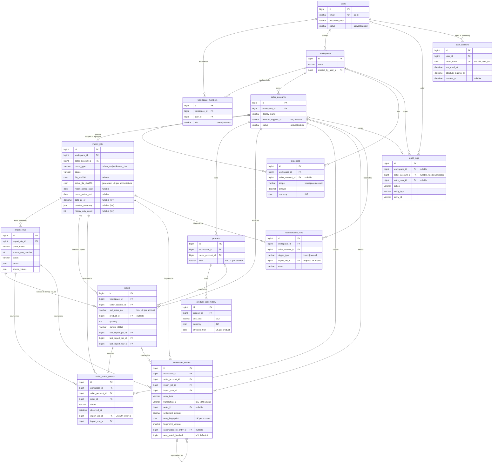

# Database schema (Milestones 2–6)

MySQL 8.0 (InnoDB, `utf8mb4` / `utf8mb4_0900_ai_ci`). Created only by the migrations in
`db/migrations` (one table per migration: `20261030000001` … `20261030000014` in Milestone 2,
`20261030000015-create-user-sessions` in Milestone 3; then column changes:
`20261030000016-add-import-jobs-data-as-of-and-preview` and `20261030000017-add-import-jobs-history-only-count`
in Milestone 4, `20261031000018-add-settlement-entries-auto-match-blocked` in Milestone 5); the app never syncs.
Milestone 6 (products, costs, expenses) added no migration: it uses the M2 tables and keys as they are.
`test/db/*.db-spec.ts` asserts everything below against a freshly migrated `meesho_test`.

## Conventions

- Primary keys: `id BIGINT UNSIGNED AUTO_INCREMENT`. Every FK column is `BIGINT UNSIGNED`.
- Timestamps: `created_at` / `updated_at` are `DATETIME(3) NOT NULL`, written in UTC by the app
  (no DB default). Append-only tables (`import_rows`, `order_status_events`, `audit_logs`) have
  `created_at` only; so does `user_sessions`, whose `last_used_at` / `revoked_at` record its changes.
- Money: `DECIMAL(12,2)`, read back as strings. **NULL = missing / not reported, 0 = zero.** No money
  column has a default. One exception in precision: `product_cost_history.unit_cost` is `DECIMAL(12,4)`
  (lot-based unit costs such as ₹1000/3); line cost = `unit_cost × quantity`, computed by MySQL in DECIMAL
  and returned exactly with 4 dp (M6: no rounding in the API, e.g. 3 × 333.3333 = 999.9999; the UI shows
  2 dp). The M2 migration comment that says "rounded half-up to 2 decimals" predates this decision.
- Currency: `product_cost_history.currency` and `expenses.currency` are `CHAR(3)` with `CHECK = 'INR'`.
  Orders and settlements carry no currency column (amounts are INR as reported).
- Enumerations: `VARCHAR` + named `CHECK` (enforced since MySQL 8.0.16), not native `ENUM`. The model
  constants in `src/database/models/enums.ts` must list the same values (asserted by the schema spec).
- Collations: external identifiers (`sku`, `catalog_id`, `sub_order_no`, `order_no`, `packet_id`,
  `transaction_id`, `meesho_supplier_id`) are `utf8mb4_bin` (exact, case-sensitive). Hashes
  (`file_sha256`, `active_file_sha256`, `row_hash`, `entry_fingerprint`, `user_sessions.token_hash`) are
  `CHAR(64) ascii_bin`.
  `users.email` is `utf8mb4_0900_as_ci` (case-insensitive, accent-sensitive). Everything else uses the
  table default.
- Constraint names: `fk_<table>_<what>`, `uq_<table>_<what>`, `ix_<table>_<what>`, `ck_<table>_<what>`.
- Delete rule: `RESTRICT` (history must survive) except the four `CASCADE`s listed below
  (`workspace_members` ×2, `import_rows`, `user_sessions`). `ON UPDATE` is always `RESTRICT`.
- No credentials anywhere: no password/cookie/token/OTP/secret column except two one-way hashes:
  `users.password_hash` (Argon2id) and `user_sessions.token_hash` (SHA-256 of the session token; the token
  itself exists only in the user's HttpOnly cookie).

## Tenancy

`seller_accounts` has `UNIQUE (workspace_id, id)`. Every account-scoped table (`import_jobs`, `products`,
`orders`, `order_status_events`, `settlement_entries`, `reconciliation_runs`, `expenses` when
account-scoped, `audit_logs` when account-scoped) carries `workspace_id` + `seller_account_id` with the
composite FK `(workspace_id, seller_account_id) → seller_accounts (workspace_id, id)`: a row can never
claim a workspace that does not own its account.

Every reference between account-scoped rows is composite, so it cannot cross accounts, and every
reference to a source row is composite with its import job, so it cannot cite a row of another file:

| Reference | Composite FK | Parent key |
| --- | --- | --- |
| order → product | `orders (seller_account_id, product_id)` | `products (seller_account_id, id)` |
| order → first / last import job | `orders (seller_account_id, first_import_job_id / last_import_job_id)` | `import_jobs (seller_account_id, id)` |
| order → source row of its current values | `orders (last_import_job_id, last_import_row_id)` | `import_rows (import_job_id, id)` |
| status event → order | `order_status_events (seller_account_id, order_id)` | `orders (seller_account_id, id)` |
| status event → import job | `order_status_events (seller_account_id, import_job_id)` | `import_jobs (seller_account_id, id)` |
| status event → source row | `order_status_events (import_job_id, import_row_id)` | `import_rows (import_job_id, id)` |
| settlement → import job | `settlement_entries (seller_account_id, import_job_id)` | `import_jobs (seller_account_id, id)` |
| settlement → source row | `settlement_entries (import_job_id, import_row_id)` | `import_rows (import_job_id, id)` |
| settlement → matched order | `settlement_entries (seller_account_id, order_id)` | `orders (seller_account_id, id)` |
| settlement → superseding entry | `settlement_entries (seller_account_id, superseded_by_entry_id)` | `settlement_entries (seller_account_id, id)` |
| reconciliation run → import job | `reconciliation_runs (seller_account_id, import_job_id)` | `import_jobs (seller_account_id, id)` |

A composite FK is not checked while one of its columns is NULL (InnoDB MATCH SIMPLE); that is intended for
the optional references (`orders.product_id`, `settlement_entries.order_id` / `superseded_by_entry_id`,
`reconciliation_runs.import_job_id`, `expenses.seller_account_id`, `audit_logs.seller_account_id`).
Workspace-only rows of `expenses` and `audit_logs` are still checked by their simple
`workspace_id → workspaces` FK, and `CHECK (seller_account_id IS NULL OR workspace_id IS NOT NULL)` on
`audit_logs` forbids an account without a workspace. Product cost history reaches its account through
`product_id`; users are global (simple FKs).

## Tables

| Table | Purpose | Uniqueness | FKs (delete rule) |
| --- | --- | --- | --- |
| `users` | Sign-in identity; `status` active/disabled, never hard-deleted | `uq_users_email` (case-insensitive, accent-sensitive) | — |
| `workspaces` | Tenant | — | `created_by_user_id` → users |
| `workspace_members` | User ↔ workspace, `role` owner/member | `(workspace_id, user_id)` | workspace **CASCADE**, user **CASCADE** |
| `seller_accounts` | One Meesho seller account; `meesho_supplier_id` is a report identifier, not a credential | `(workspace_id, display_name)`, `(workspace_id, meesho_supplier_id)`, `(workspace_id, id)` | workspace |
| `import_jobs` | One uploaded file: type, lifecycle status, size, sha256, optional report period, counts, failure; `data_as_of` (M4: when the report's statuses were current), `preview_summary` JSON (M4: sheets, column names — at most 100 per list — and planned counts; never row values) and `history_only_count` (M4: older-report rows recorded as status history only). The raw file is not stored (`storage_key` stays NULL) | `(seller_account_id, id)`; `(seller_account_id, report_type, active_file_sha256)`; `(seller_account_id, file_sha256)` is a plain index | account (composite), created_by / confirmed_by → users |
| `import_rows` | Every non-blank source row: sheet, row number as the user sees it, status, action, `errors` JSON `[{field, reason}]`, normalized `source_values` JSON (mapped columns only), `row_hash` (settlement rows: entry fingerprint; order rows: sha256 of the normalized values). Cancelling an import deletes its rows (the job stays) | `(import_job_id, sheet_name, source_row_number)`, `(import_job_id, id)` | import job **CASCADE** |
| `products` | SKU per account, `status` active/archived | `(seller_account_id, sku)`, `(seller_account_id, id)` | account (composite) |
| `product_cost_history` | Effective-dated unit cost (`DECIMAL(12,4)`, `>= 0`, INR) | `(product_id, effective_from)` | product, created_by → users |
| `orders` | Canonical order line = Meesho sub-order; raw `current_status` + observed time; first/last import job and the source row of the current values | `(seller_account_id, sub_order_no)`, `(seller_account_id, id)` | account, product, first/last import job, last import row (all composite) |
| `order_status_events` | Append-only status observations, account-scoped | `(order_id, import_job_id)` | account, order, import job, import row (all composite) |
| `settlement_entries` | One settlement workbook row; `entry_type` per sheet; amounts as reported; `is_estimate`; fingerprint + version; supersession; match fields; `auto_match_blocked` (M5: `TINYINT(1) NOT NULL DEFAULT 0`, set by a manual unmatch so auto-match skips the entry) | `(seller_account_id, entry_fingerprint)`, `(seller_account_id, id)`; `transaction_id` is an index, **not unique** | account, import job, import row, order, superseding entry (all composite); matched_by → users |
| `expenses` | Manual expense, `scope` workspace/account, `amount > 0`, INR | — | workspace; account (composite); created_by → users |
| `reconciliation_runs` | One matching run: `trigger_type`, status, counts; has `updated_at` (status changes) | — | account, import job (composite); triggered_by → users |
| `audit_logs` | Append-only audit trail; scope none / workspace / workspace + account; `actor_user_id` NULL = system; before/after JSON without secrets or full rows | — | workspace; account (composite); actor → users |
| `user_sessions` | Server-side sign-in session (M3): SHA-256 `token_hash`, `last_used_at` (idle timeout), `absolute_expires_at`, `revoked_at`; no IP / user agent | `uq_user_sessions_token_hash`; plain indexes on `user_id`, `absolute_expires_at` | user **CASCADE** |

CHECKs beyond the enumerations:

- `ck_orders_quantity` (`quantity > 0`), `ck_product_cost_history_unit_cost` (`>= 0`),
  `ck_expenses_amount` (`> 0`), `ck_product_cost_history_currency` / `ck_expenses_currency` (`= 'INR'`).
- `ck_expenses_scope_account`: `workspace` ⇔ `seller_account_id IS NULL`, `account` ⇔ set.
- `ck_import_jobs_report_period`: `report_period_end >= report_period_start` when both are set.
- `ck_settlement_entries_match_consistency`: `match_method IS NULL` ⇔ `order_id IS NULL`;
  `ck_settlement_entries_manual_match`: `manual` ⇒ `matched_by_user_id` and `matched_at` set;
  `ck_settlement_entries_auto_match`: `auto` ⇒ `matched_at` set.
- `ck_reconciliation_runs_import_job`: `trigger_type = 'import'` ⇒ `import_job_id` set.
- `ck_audit_logs_account_workspace`: `seller_account_id IS NULL OR workspace_id IS NOT NULL`.

Not enforceable in MySQL: `superseded_by_entry_id <> id` (a CHECK may not reference an `AUTO_INCREMENT`
column, error 3818, and creating triggers is not granted). The M5 supersession code must refuse
self-references and cycles.

## Sessions (Milestone 3)

- A session is valid while `revoked_at IS NULL`, `now < absolute_expires_at` and
  `now - last_used_at < SESSION_IDLE_MINUTES`, and its user is `active`. `last_used_at` is refreshed at
  most every 5 minutes, so the idle timeout can end a session up to 5 minutes early, never late.
- Logout and a new login/registration presenting a session set `revoked_at` (the row stays until the
  user's next login). At each login the user's revoked and expired rows are deleted.
- `users.last_login_at` is set at registration and at each successful login.

## Deletion behaviour

- A workspace with seller accounts (or expenses / audit rows) cannot be deleted; a workspace without them
  can, and its `workspace_members` rows go with it.
- Deleting an import job removes its staging `import_rows`, but fails once any canonical row
  (order, status event, settlement entry, reconciliation run) references the job or one of its rows.
- Products, orders, accounts and users referenced by history cannot be deleted (archive / disable instead).
  A user's sessions go with the user (CASCADE).

## Idempotency rules

- **Import jobs (same file)**: `active_file_sha256` is a STORED generated column,
  `IF(status IN ('importing','completed'), file_sha256, NULL)`, with
  `UNIQUE (seller_account_id, report_type, active_file_sha256)`. Only one importing/completed import per
  file, account and report type; pending, previewed, failed and cancelled jobs stay retryable (NULL is not
  unique). `(seller_account_id, file_sha256)` remains a plain index for finding earlier uploads of a file.
- **Orders**: `UNIQUE (seller_account_id, sub_order_no)`. Re-importing a file or an overlapping report
  updates the existing order instead of inserting a duplicate.
- **Status events**: `UNIQUE (order_id, import_job_id)`: one observation per order per import. Re-running
  the same import adds nothing; a later overlapping import adds a new observation (history preserved).
- **Observation time (M4)**: `observed_at` = `import_jobs.data_as_of`. For an orders CSV that is the end
  (23:59:59.999 India time) of the day the user says the report was downloaded (required at upload); for a
  workbook, the upload time. `orders.current_status`, `current_status_observed_at`, `last_import_job_id` and
  `last_import_row_id` (and the other order values) move forward only when
  `data_as_of >= current_status_observed_at` (an equal time counts as forward), so importing an older report
  never overwrites a newer status: its observation is still recorded and counted in
  `import_jobs.history_only_count`. A blank cell in a newer report never erases a value an earlier report gave.
- **Settlement entries**: `UNIQUE (seller_account_id, entry_fingerprint)`. Fingerprint version 2 (what the
  importer writes since the M4 review) is a sha256 over the sheet's profile key (not its raw name) and the
  values of that sheet's REQUIRED columns only — Order Payments: `sub_order_no`, `transaction_id`,
  `payment_date`, `settlement_amount` (transaction id and payment date may be blank); the other sheets: their
  amount and date — plus the occurrence index among identical tuples in the same file. `entry_type` is not
  hashed: the sheet key fixes it, except on "Compensation and Recovery" where it comes from the optional Type
  column or the sign. Optional columns (sale, commission, TCS, order date, Type, …) never enter it, so adding, dropping or
  renaming one, or a 0 versus a blank in one, cannot create duplicates. `fingerprint_version` (no default;
  set by the importer) records which definition was used. Re-importing the same file or an overlapping
  report is a no-op; two genuinely separate rows with the same `transaction_id` stay separate
  (`transaction_id` is never unique). Confirms of one account are serialised (account row `FOR UPDATE`,
  READ COMMITTED), so two overlapping imports never both insert the same fingerprint.
- **Supersession**: `superseded_by_entry_id` marks an entry replaced by a later entry of the same account
  (e.g. an estimate replaced by the final figure). Totals sum only rows where
  `superseded_by_entry_id IS NULL`. Nothing sets it yet: no real file shows how Meesho revises figures
  (`is_estimate` is never set), so the supersession logic is deferred (M5 decision). Every M5 total,
  exception list and match already excludes superseded rows, so a later milestone can add it safely.

## Settlement ↔ order matching (Milestone 5)

- **Match state** of an entry: `matched` when `order_id` is set; else `unmatched` when `sub_order_no` is
  set; else `account_level` (ads, referral, … without a sub order: never an exception).
- **Auto-match** (`reconciliation_runs.trigger_type` `import` inside every completed import's confirm
  transaction, or `manual`): an entry with `sub_order_no` set, `order_id` NULL,
  `superseded_by_entry_id` NULL and `auto_match_blocked = 0` gets the order of the same account with the
  same `sub_order_no` (exact, both `utf8mb4_bin`): `order_id`, `match_method = 'auto'`, `matched_at`. It
  never touches an existing match (manual or auto), so nothing is re-pointed. An `import` run only looks at
  what its job can newly match: a settlement import at entries with its `import_job_id`, an orders import at
  entries whose order has its `first_import_job_id` (indexes `ix_settlement_entries_account_import_job`,
  `ix_orders_account_first_import_job`); a `manual` run checks the whole account.
- **Manual match** (owner): `match_method = 'manual'`, `matched_by_user_id`, `matched_at`, and
  `auto_match_blocked = 0`. **Manual unmatch** (owner): clears `order_id`, `match_method`, `matched_at`,
  `matched_by_user_id` and sets `auto_match_blocked = 1`. The match CHECKs above hold in every state.
- A run records `matched_count` (entries it matched) and, after matching, `unmatched_settlement_count`
  (entries with a sub order, no order, not superseded) and `unmatched_order_count` (orders with no matched,
  non-superseded entry).

## Effective-dated cost rule

Effective unit cost on date D = the `product_cost_history` row with the greatest `effective_from <= D`.
There is no `effective_to`, so ranges cannot overlap; `UNIQUE (product_id, effective_from)` allows one
cost per start date. No such row ⇒ cost **unknown** (profit incomplete), never zero.

M6 implements it in one file, `src/products/effective-cost.ts`, in two equivalent forms: a LEFT JOIN on the
row whose `effective_from` is `MAX(effective_from) <= D` (served by that unique key) for orders, where D = the
ORDER date; and grouped per-account CTEs for product lists, where D = today in India for `currentCost` and an
order has no cost exactly when its date is before the product's first `effective_from`.

## Product ↔ order mapping (Milestone 6)

Invariant: for every order, `orders.product_id` is the product of the same account with the same `sku` (exact:
both columns `utf8mb4_bin`), or NULL when the order has no SKU or no product has that SKU. It holds because
every write that can break it repairs it for every order of the account with the affected SKU, in the same
transaction and under the account row lock:

- an orders import confirm creates the missing products for its SKUs, re-links the orders it observed (an order
  whose SKU changed in a newer report moves to the right product), then re-links every other order of the
  account carrying one of those SKUs (orders imported earlier, e.g. before M6);
- a product created by hand links every order with its SKU; `POST .../products/sync` creates the missing products
  for every SKU of the account and re-links every order (idempotent);
- products are never deleted and their SKU never changes; an order's SKU changes only through an import (a
  blank cell never erases it).

Orders imported before M6 whose SKU appears in no later import have `product_id` NULL because no product has
their SKU yet (the invariant holds; their cost state is `no_product`) until `POST .../products/sync` creates the
products. Manual edits of `products` / `orders.product_id` outside the app can break it; sync repairs that.
One product per SKU: several SKUs cannot share a product.

## Deferred

- `bank_payouts`: optional until bank statements are imported (blueprint §5).
- Refresh tokens: none (server-side sessions instead, Milestone 3).

## ER diagram

